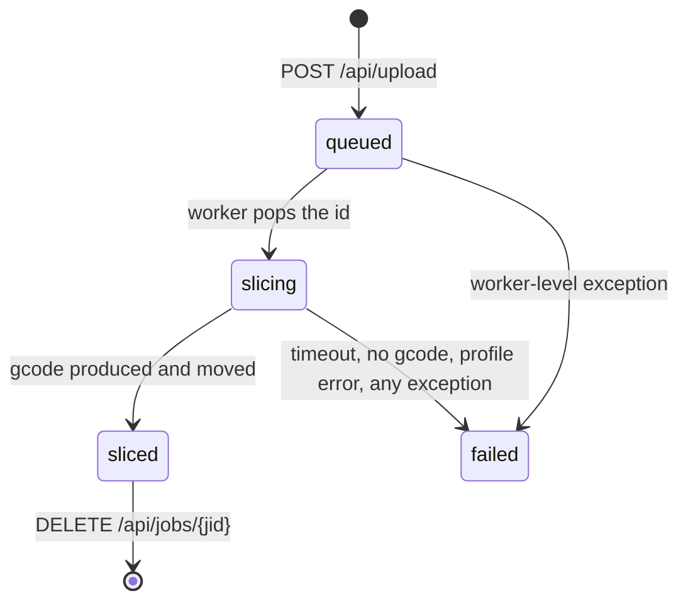

# Architecture

print-portal is one container: a FastAPI app that slices an uploaded model with the OrcaSlicer CLI
and hands the resulting `.gcode` to Moonraker over HTTP. No database, no shared filesystem with the
printer host (`AGENTS.md`, `app/main.py` module docstring).

**Two states are documented.** **A** = `develop` @ `dc92ca1` (this worktree). **B** = the uncommitted
`ergo/20261022T123034Z-import-name` branch, read from a read-only snapshot of the live tree. The job
pipeline below is the same in both; the seed contents and the preset behaviour are not — see
[presets.md](presets.md) and the `data/` table at the end.

## Components

| Module | Responsibility |
|---|---|
| `app/main.py` | Routes, job storage, the slicing worker thread, printer resolution. `app = FastAPI(...)`, `lifespan` starts the worker (`main.py:725-732`). |
| `app/config.py` | The only module that reads `os.environ`. `load_config()` → frozen `Config` dataclass (`config.py:123`). |
| `app/profiles.py` | Preset import, normalisation, derived options preset, machine/process compatibility. See [presets.md](presets.md). |
| `app/printers.py` | Printer store (`printers.json` + Fernet-encrypted keys), the env seed row, pairing validation. |
| `app/moonraker.py` | Moonraker HTTP client; maps transport/HTTP failures onto `MoonrakerError` subclasses carrying `http_status` (`moonraker.py:46-69`). |
| `app/threemf.py` | Reads a 3MF's embedded printer/process identity and rewrites a job-local copy that names local presets. |
| `app/supportfins.py` | Wraps the bundled `app/support_fins.mjs`: `available()`/`unavailable_reason()`, and `fin_model()` — one `node` run with `--json`, bounded by `SUPPORT_FINS_TIMEOUT`, serialised by `_RUN_LOCK`, failures as `SupportFinsError`/`SupportFinsUnavailable`. |
| `app/preview.py` | Reads a job's 3MF/STL/OBJ geometry for the pre-slice preview (`read_scene`), one object per leaf with `role: "part"` or `"supports"`, capped by `MAX_TRIANGLES` (200 000) and `MAX_BYTES` (12 MiB). No network, no UI. |
| `app/archives.py` | Picks one model out of an uploaded `.zip`, fail-closed on hostile members. |
| `app/gcode.py` | Parses the slicer's gcode header for grams/time/layers (`MAX_HEAD_BYTES = 2_000_000`). |
| `app/index.html` | The whole UI, inline CSS/JS. Served by `GET /`. |

## Request flow

```mermaid
sequenceDiagram
    participant B as Browser
    participant F as FastAPI (main.py)
    participant Q as queue.Queue + worker thread
    participant S as OrcaSlicer CLI
    participant D as data/ + SLICED_DIR
    participant M as Moonraker

    B->>F: POST /api/upload (multipart file)
    F->>F: reject_oversize → suffix check → require_machine()
    F->>D: jobs/<jid>/upload/<name>
    F->>F: profile_snapshot() (machine/process/filament + options)
    F->>D: jobs/<jid>/job.json {"status":"queued", ...}
    F->>Q: job_queue.put(jid)
    F-->>B: 200 {"id","status":"queued","queue_position"}
    Q->>S: orca-slicer --load-settings <machine>;<derived process> --load-filaments <filament>
    S->>D: out/*.gcode + result.json
    Q->>D: move gcode → SLICED_DIR/<jid>/<output_name>.gcode, job.json status=sliced
    B->>F: GET /api/jobs (poll)
    B->>F: POST /api/jobs/{jid}/print
    F->>M: printer_status() → upload → start_print
    F-->>B: {"started": true, "remote_file": ...}
```

### How one job runs

1. `api_upload` (`main.py:989`) rejects an oversize body from `Content-Length` before buffering
   (`reject_oversize`, `main.py:735`), checks the suffix against `ALLOWED = {".stl", ".3mf", ".obj",
   ".zip"}`, then calls `require_machine()` **before** creating the job directory — a 409 leaves
   nothing behind (`main.py:997`).
2. The file is streamed to `jobs/<jid>/upload/<name>` in 1 MiB chunks with a running byte count
   (`main.py:1005-1011`). A `.zip` is unpacked by `archives.extract_model`; the archive itself stays
   in the job dir, the extracted member is what gets sliced.
3. A `.3mf` goes through `prepare_3mf` (`main.py:914`): match the file's printer/process against local
   presets, select the matching printer, and rewrite the identity into `upload/slice-<stem>.3mf`.
4. `job.json` is written with `status: "queued"` (or `"awaiting_confirm"` when support fins are on —
   see *Staged jobs* below), the upload name, `profile_snapshot` and — when
   relevant — `archive`, `threemf`, `slicer_input`. The id is then queued.
5. The worker thread (`worker`, `main.py:692`) pops the id and runs `run_slice` (`main.py:615`).
6. `run_slice` sets `status: "slicing"`, resolves the presets (`slice_profile` trusts a job snapshot
   only when all three paths still resolve inside the datadir, `main.py:593`), writes the derived
   options preset under `DERIVED_LOCK`, and runs:

   ```text
   <ORCA_BIN> --datadir <ORCA_DATADIR>
              --load-settings <machine.json>;<system/Custom/process/print-portal-options.json>
              --load-filaments <filament.json>
              --slice 0 --outputdir <job>/out <input>
   ```

   The subprocess gets a hand-built environment (`main.py:630-637`): `PATH`, `HOME=<data>/home`,
   `QT_QPA_PLATFORM=offscreen`, `DISPLAY=""`, `LC_ALL=C.UTF-8`, `TMPDIR=<data>/tmp`. It does not
   inherit `MOONRAKER_API_KEY`.
7. Success moves the first `*.gcode` to `SLICED_DIR/<jid>/<output_name>.gcode`, parses stats with
   `parse_gcode_stats`, and writes `status: "sliced"`, `elapsed`, `gcode`, `stats`, `layer_height`
   (`main.py:669-687`). With no gcode the job fails with `result.json`'s `error_string`, else the tail
   of the slicer's output (`main.py:674-677`).
8. `POST /api/jobs/{jid}/print` requires `status == "sliced"`, Klipper `webhooks == "ready"` and
   printer `state` in `("standby", "complete")`, then uploads and starts the print
   (`main.py:1090-1119`).

### Job state



`ACTIVE_STATUSES = ("queued", "slicing")` (`main.py:65`). Nothing in the UI, and no route, rewrites a
terminal state. `prune()` keeps the `KEEP_JOBS` newest finished job directories and never removes an
active one (`main.py:710-722`).

### Staged jobs (support fins)

`POST /api/upload` with `support_fins=true` is the one upload that does not end in `queued`: the CLI
runs inside the request (`supportfins.fin_model`, serialised on `_RUN_LOCK`) and the job is written as
`awaiting_confirm`, not enqueued. `POST /api/jobs/{jid}/slice` performs the only
`awaiting_confirm → queued` transition, under `STAGE_LOCK`, so a double click is a 409 rather than a
second queue entry. The 3MF is prepared (`prepare_3mf`) *before* finning, because the CLI's output
carries no OrcaSlicer identity metadata; the rewritten copy is then deleted, so a finned job has
`slicer_input: None` and `threemf["rewrite"] == "discarded"` with an explanatory note.

Because `awaiting_confirm` is absent from `ACTIVE_STATUSES`, such a job lists and deletes like a
finished one but is excluded from age pruning via PRUNE_KEEP_STATUSES, while
it under an open preview dialog. The worker never sees it, so `run_slice` needed no change.
`GET /api/jobs/{jid}/preview` serves its geometry through `preview.read_scene` (stdlib `zipfile` +
`ElementTree`), which is also why the preview cannot drift from the file that will be sliced.

### Concurrency

One daemon thread (`worker`) consumes `queue.Queue`; slices are therefore serialised. `DERIVED_LOCK`
(`main.py:94`) spans writing the derived process preset, building the argv and running the slicer, so
a concurrent options save cannot replace the file a running slicer is loading.

## What lives in `data/` vs the image

Both are writable state in the container; only the image half survives a container rebuild.

| Path | Where | Created by | Contents |
|---|---|---|---|
| `/app` | image | `COPY app /app` (`Dockerfile:65`) | the application code |
| `/opt/orca` | image | `Dockerfile:2-19` | OrcaSlicer 2.4.2 AppImage, extracted, with a wrapper that sets `LC_ALL=C` |
| `/opt/orca-datadir` | image (read-only seed) | `COPY presets/datadir /opt/orca-datadir` (`Dockerfile:66`) | **A:** 11 preset files incl. `system/Custom/machine/generic-klipper-0.4.json`. **B (uncommitted):** `system/Custom.json` only, four empty lists |
| `/opt/smoke` | image | `Dockerfile:69-71` | `cube.stl` and `portal-import.orca_printer` for the build-time slice |
| `$DATA_DIR/jobs` | volume | `entrypoint.sh:15`, `main.py:79` | one directory per job: `upload/`, `out/`, `job.json` |
| `$SLICED_DIR` | volume | `main.py:82` | finished gcode, `<jid>/<output_name>.gcode` |
| `$DATA_DIR/home` | volume | `entrypoint.sh:15` | `HOME` for the slicer subprocess (Qt config) |
| `$DATA_DIR/tmp` | volume | `entrypoint.sh:15` | `TMPDIR` for Starlette's spooled uploads |
| `$DATA_DIR/profile.json` | volume | `write_profile_file` (`main.py:391`) | active preset paths, `machine_label`, `options` |
| `$DATA_DIR/printers.json` | volume | `printers.py` store | printer rows incl. pairing; API keys encrypted |
| `$DATA_DIR/secret.key` | volume | `printers.py` store | Fernet key for `printers.json` |
| `$DATA_DIR/orca-datadir` | volume | `entrypoint.sh:16-20` | writable copy of the seed plus every imported preset |

Seeding runs when `.seed-version` in `$ORCA_DATADIR` does not equal `SEED_VERSION`
(`entrypoint.sh:16`). The copy is `cp -R -n` — **no-clobber** — so bumping `SEED_VERSION` only adds
files that are missing; it never rewrites an imported preset.

`data/` is therefore the unit of backup: `profile.json`, `printers.json`, `secret.key` and
`orca-datadir/` are the only state that cannot be rebuilt from the image.
