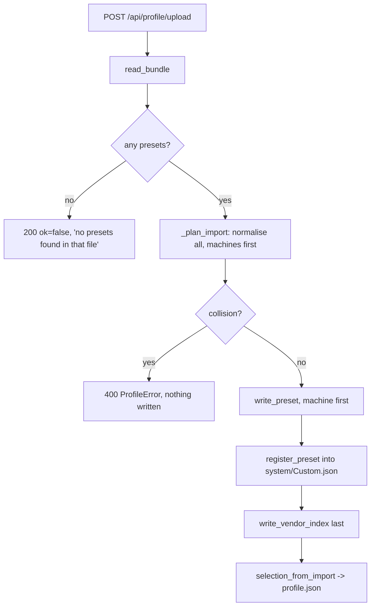

# Preset pipeline

Two states exist right now and they behave differently. This page documents both, separately. Nothing
in **B** is in `develop`.

| | State | What was read | Status |
|---|---|---|---|
| **A** | `develop` @ `dc92ca1` | this worktree — `app/profiles.py`, `app/main.py`, `presets/datadir/` | shipped |
| **B** | `ergo/20261022T123034Z-import-name` | read-only snapshot of `/home/pank/projects/print-portal` (~27 dirty files, uncommitted) | **in progress — NOT in develop** |

Verified before writing: none of `VENDOR_LISTS`, `NO_MACHINE_MESSAGE`, `read_vendor_index`,
`require_machine`, `selection_from_import` or `"imported": False` exists in `dc92ca1` (`grep -F` over
`app/profiles.py app/main.py` → 0 matches), and `dc92ca1`'s `presets/datadir/` ships 11 preset files.
Everything attributed to B below comes from the snapshot.

One thing is identical in both states: the **`-17` rule** (§3) — which A misdiagnosed. That misdiagnosis
is the reason A's import merges onto a stock slot at all.

## 1. State A — what `develop` does today (`dc92ca1`)

### The seed ships a usable machine

`presets/datadir/` has 11 files, including `system/Custom/machine/generic-klipper-0.4.json`,
`system/Custom/process/generic-0.20-standard.json`, `system/Custom/filament/generic-pla.json` plus the
`fdm_*` bases. `docker/entrypoint.sh:16-20` copies them into `$ORCA_DATADIR` when `.seed-version` does
not equal `SEED_VERSION` (`2.4.2-1`, `Dockerfile:31`), with `cp -R -n` (no-clobber).

A fresh install can therefore slice immediately with the stock Generic Klipper preset. No import is
required.

### Machine resolution is mandatory and raises

`machine_slot` (`profiles.py:145`) resolves: `MACHINE_SLOT` override → `DEFAULT_PROFILE["machine"]`
(`system/Custom/machine/generic-klipper-0.4.json`) → first `system/**/machine/*.json` with
`type == "machine"` and `instantiation == "true"` → **raise**:

```python
raise ProfileError(f"no machine preset found in {datadir} (set MACHINE_SLOT)")   # profiles.py:189
```

That is the literal at the raise site. A has no "empty installation" state: with no machine preset,
`active_paths()` (`main.py:308`) raises, nothing catches `ProfileError` at the HTTP layer (`main.py` has
no `@app.exception_handler`), and `GET /api/profile` (`main.py:1092`), `POST /api/upload` (via
`profile_snapshot()`, `main.py:979`) and `POST /api/profile/upload` (`main.py:1150`) answer **500**.

### Import merges onto the stock slot

`import_into(datadir, blob, filename, slot, bed)` (`profiles.py:616`) takes the resolved slot:

* **machine** preset → merge onto the slot document, skipping
  `MACHINE_IDENTITY = {"name", "inherits", "from", "type", "compatible_printers", "printer_model",
  "printer_variant"}`: the slot keeps its identity, the bundle overwrites everything else
  (`profiles.py:642-662`);
* the untouched slot is backed up once as `<slot>.json.orig` (`profiles.py:634-636`);
* **process/filament** → normalised and written to `system/Custom/<type>/<safe_stem(name)>.json`, with
  `compatible_printers` rewritten to the **slot's** name (`normalise`, `profiles.py:243`);
* the slot's `default_print_profile` / `default_filament_profile` are re-pointed at the imported
  presets (`profiles.py:681-690`);
* the returned note is: `machine '<name>' applied onto the stock preset '<slot>' (Orca rejects new
  machine identities with -17)` (`profiles.py:668`).

No vendor-index work happens in A: `system/Custom.json` ships pre-filled and the app never rewrites it.

User-visible consequence: the printer keeps the stock slot's name; the bundle's name survives only as
`machine_label` in `profile.json` (`main.py:1097`).

### Why A is built that way

`README.md:271-279` (state A) gives the rationale: "OrcaSlicer's CLI refuses a machine preset that is
not the identity it expects: a bundle machine written under its own name returns `-17` … even when the
process lists that exact name in `compatible_printers`. … Import therefore merges the bundle machine
onto the resolved machine slot."

That premise is wrong (§3): patching `compatible_printers` does make the same machine slice. The merge
is a workaround for a misdiagnosis, and it is why A cannot show the bundle's real printer name.

## 2. State B — uncommitted, NOT in `develop`

### The seed ships no presets

`presets/datadir/` holds one file, `system/Custom.json`, with four empty lists
(`machine_model_list`, `process_list`, `filament_list`, `machine_list`). `SEED_VERSION` is `2.4.2-2`.
Import becomes the only way in.

### Resolution returns `None`; reads never fail, actions 409

`machine_slot` (`profiles.py:241`) keeps steps 1–3 and replaces the raise with `return None`; a bad
**override** is still a `ProfileError`.

```python
NO_MACHINE_MESSAGE = "no printer profile imported yet"   # profiles.py:63
def require_machine()   -> dict[str, Path]   # 409 no_printer_profile     main.py:354
def selection_or_none() -> dict | None       # None, never raises        main.py:368
```

* `GET /api/profile` answers **200** with `"imported": false`, `"source": "none"`, null
  paths/presets/effective/derived (`main.py:1152-1168`).
* `POST /api/upload`, `POST /api/profile/select`, and `resolve_pairing()`'s explicit-pairing branch
  answer **409** with `{"error": "no_printer_profile", "detail": "no printer profile imported yet",
  "hint": "upload an .orca_printer bundle exported from OrcaSlicer (…)"}` (`NO_PRINTER_DETAIL`,
  `main.py:336`).

### Import writes every machine under its own name

`import_into(datadir, blob, filename, bed)` (`profiles.py:762`) no longer takes a slot. Two phases, so a
refused import writes nothing:



Snapshot symbols: `read_bundle` `profiles.py:376`, `_plan_import` `profiles.py:709`, `write_preset`
`profiles.py:215`, `register_preset` `profiles.py:183`, `write_vendor_index` `profiles.py:203`,
`import_into` `profiles.py:762`, `selection_from_import` `main.py:1183`.

`normalise` (`profiles.py:323`) differs from A:

| Field | Machine | Process / filament |
|---|---|---|
| `from` | forced `"system"` | `"User"` (keeps `"user"`) |
| `instantiation` | forced `"true"` | untouched |
| `inherits` | **kept verbatim**; a dangling parent is allowed (A re-rooted it to a shipped base) | same |
| `compatible_printers` | `[own name]` | `[the bundle's machine name]`, else kept as-is with a note |
| `printable_area` | clamped to `BED_SIZE` | n/a |

Name collision is refused before any write:

```text
<datadir>/system/Custom/<type>/<name>.json already holds a different preset named '<name>';
delete that file and re-import if you want to replace it
```

`_plan_import` raises it; `_same_preset` (`profiles.py:228`) makes re-importing the same bundle
idempotent (`setting_id`, else normalised-document equality).

### Registration in `system/Custom.json`

| Type | List | Entry |
|---|---|---|
| machine | `machine_list` | `{"name": …, "sub_path": "machine/<file>.json"}` |
| process | `process_list` | `{"name": …, "sub_path": "process/<file>.json"}` |
| filament | `filament_list` | `{"name": …, "sub_path": "filament/<file>.json"}` |

`VENDOR_LISTS` (`profiles.py:68`), keyed on `name` (re-import updates in place, `register_preset`
`profiles.py:183`). `read_vendor_index` (`profiles.py:163`) treats a missing/corrupt index as empty.
The index is written **last**, so a crash leaves an unreferenced file rather than an entry pointing at
nothing. The CLI never opens this file — it is the portal's registry and what the picker reads
(`list_presets`, `profiles.py:638`).

### Selection follows the import

`selection_from_import` (`main.py:1183`) writes the machine + first process + first filament just
imported into `profile.json` (plus `machine_label`), because otherwise `machine_slot` would pick the
first machine alphabetically once a second bundle exists.

### Files on disk after an import (B)

For `tests/fixtures/portal-import.orca_printer` (`printer/ender-3-v3-se.json`,
`process/portal 0.20 standard.json`, `filament/portal pla.json`):

```text
system/Custom/machine/ender-3-v3-se.json          from:"system", compatible_printers:["ender-3-v3-se"]
system/Custom/process/portal_0.20_standard.json   from:"User",  compatible_printers:["ender-3-v3-se"]
system/Custom/filament/portal_pla.json            from:"User"
system/Custom.json                                three *_list entries added
profile.json                                      the three paths + machine_label
```

Spaces become `_` (`safe_stem`, `profiles.py:157`) because the CLI chokes on spaces in preset filenames.

## 3. The `-17` rule — same in both states; A's reading of it was wrong

`-17` is the **process↔machine compatibility check**, not a restriction on what a machine preset may be
called.

The CLI prints it; we never raise it, so it cannot be grepped out of this repository. Where the literal
is recorded:

* `app/threemf.py:6` (state A): `-17` `("the selected printer is not compatible with the process preset")`
* in-progress `app/profiles.py:31-43`, with the `from` measurements
* in-progress `docs/orcaslicer-presets.md`, Gotchas: "The CLI rejects the pair, not the machine … Patch
  `compatible_printers` and the same machine slices `rc=0` `"Success."`"

| Symptom | Actual cause | Fix |
|---|---|---|
| `-17` "The selected printer is not compatible with the process preset in the 3mf" | the process preset's `compatible_printers` does not name the machine being sliced | import rewrites the field (B), or fix it |
| `-17` with a machine preset carrying `"from": "user"` | the `from` literal, not the name | must be `"system"`; B forces it |
| `251` "The input preset file is invalid and can not be parsed" | machine `from` is `"System"` / `"SYSTEM"` / absent | must be lowercase `"system"` |

`from` behaviour is recorded as measured with OrcaSlicer **2.4.2** (pinned AppImage, `Dockerfile:4-5`)
in in-progress `profiles.py:31-43`: machine `"user"` → `-17`, `"System"`/`"SYSTEM"`/missing → `251`;
process/filament mirror it (`"User"`/`"user"` accepted, `"System"` invalid).

**Why this matters for A.** A's design rests on the claim that a bundle machine under its own name
returns `-17` *even when `compatible_printers` names it* (`README.md:274-276`, `profiles.py:31-35`).
That is the same claim the `-17` refutation contradicts: if the process lists the machine, the pair
slices. A therefore keeps a workaround for what was really a missing/mismatched `compatible_printers`
(plus, separately, the `from` literal), and pays for it with the printer's name.

Both states still guard the pair before writing: `_reject_unpermitted_pair` (`main.py:260`) → 400 from
`/api/profile/select`, 409 from the printer routes; `filter_process_by_machine` (`profiles.py:688`)
narrows the picker. Name comparison is lenient (`_preset_name`, `profiles.py:664`: casefold, `_`→space,
trailing `*` dropped, `@printer` suffix split off).

## 4. Derived options preset — identical in both states

`supports`, `brim`, `hide_profiles` (`OPTION_KEYS`, `profiles.py:46`) stay out of the selected preset.
`write_derived_process` (`profiles.py:448`) writes a copy to
`system/Custom/process/print-portal-options.json` named `"<preset> (portal options)"`, `from: "system"`:

| Option | Fields |
|---|---|
| `supports` | `enable_support` = `"1"`/`"0"` |
| `brim: true` | `brim_type: "outer_only"`, `brim_width` = own/inherited value, else `"5"` |
| `brim: false` | `brim_type: "no_brim"`, `brim_width: "0"` |

Hidden from the picker (`list_presets` skips `PORTAL_PROCESS_FILE`), regenerated per slice and per
options save, reported as `derived.stale` (`derived_state`, `profiles.py:517`).

## 5. 3MF identity — identical in both states

A 3MF names its own printer/process in `Metadata/project_settings.config`; giving it to the CLI beside
`--load-settings <local machine>` yields `-17` even after a local preset is selected
(`app/threemf.py:1-16`). `prepare_3mf` (`main.py:914`) matches that identity, applies the pair only when
the machine permits the process (`_paired_process`, `main.py:245`), and writes a job-local
`upload/slice-<stem>.3mf` via `threemf.rewrite_identity`. Recorded as `threemf.rewrite` =
`identity`/`stripped`/`none` plus `threemf.notes`.

## UNVERIFIED

* **B may change before it lands.** Re-read `app/profiles.py` on that branch before trusting the symbol
  names or line numbers above; the snapshot is uncommitted work by another agent.
* Whether `-17`/`251`/`from` behave the same on OrcaSlicer > 2.4.2. What would confirm: re-run the
  bisect recorded at in-progress `profiles.py:31-43` against the newer binary.
* Whether A's merge path was ever tested with a bundle whose `compatible_printers` named the machine.
  A's comment (`profiles.py:31-35`) claims "every other variant stayed at -17"; no artifact of those
  runs exists in the repo. A single slice with a patched `compatible_printers` would settle it.
