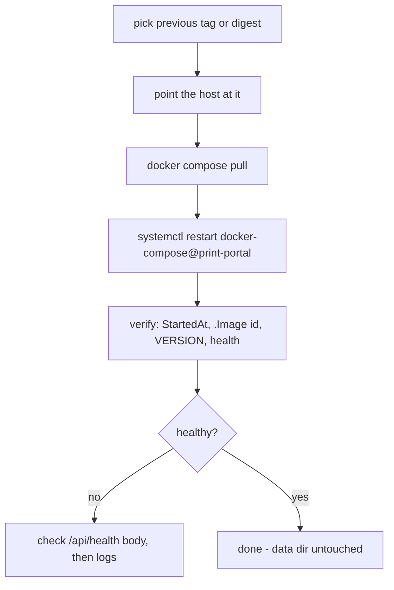

# Runbook

Operations for a running print-portal: what to check after a deploy, how to roll back, what a restart
does to presets, and what a fresh installation looks like.

Scope: this page owns **operations**. `deployment.md` owns the reverse proxy, the mounts, how CI
publishes the image and how the deploy job asserts the digest — linked, not repeated here.

Two states are referenced below. **A** = `develop` @ `dc92ca1` (this worktree). **B** = the uncommitted
`ergo/20261022T123034Z-import-name` branch. Where a step differs, it says which.

## 1. Verify a deploy is the build you think it is

The pipeline asserts the digest on the host (see `deployment.md` → "What the deploy asserts"). These are
the checks you run yourself, in order, and they answer a different question: *is this container running
the image I just built?*

```bash
# 1. what is running
sudo docker inspect -f '{{.Config.Image}} {{.Image}} {{.State.Status}} {{.State.StartedAt}}' print-portal

# 2. when that image was built  (Created)
sudo docker image inspect -f '{{.Created}} {{.Id}}' dockerhub.pkatopodis.me/pank85/print-portal:latest
```

Read them together: `StartedAt` must be **later** than the image's `Created`, and the container's
`.Image` must equal the image's `.Id`. A container started before the build timestamp is the previous
build, no matter what `:latest` points at now.

```bash
# 3. the version the running code reports, read from inside the container
sudo docker exec print-portal python -c "import config; print(config.VERSION)"
# and the same value over HTTP
curl -fsS http://127.0.0.1:8088/api/health
# {"status":"ok","app":"print-portal","version":"2.1.0"}
```

`config.VERSION` is the single version source (`app/config.py:21`) and `.gitlab-ci.yml`'s `APP_VERSION`
must equal it (`tests/test_config.py` enforces that). Two builds of the same version therefore share the
version string — use the timestamps and image id above to tell them apart; the version is a sanity check,
not a build identifier.

```bash
# 4. health
sudo docker inspect -f '{{.State.Health.Status}}' print-portal     # healthy
curl -fsS http://127.0.0.1:8088/api/health                          # 200 + version
```

`/api/health` answers **503** in two cases, both meaningful: a data directory that is not writable, or
**no printer configured** (`api_health`, `app/main.py:755`). So a portal deployed without a printer rows
sits `unhealthy` while the API itself is fine — that is the first thing to check when the health poll
fails.

## 2. Roll back

Prerequisites: you know which build you want back. CI pushes three tags per build
(`deployment.md` → "Publishing the image from CI"): `<short-sha>`, `<APP_VERSION>-<short-sha>` and
`latest`. The digest recorded by the deploy job is the authoritative identifier; a tag is a name for it.



On the host, from the compose project:

```bash
cd ~/homeserver/docker-compose/print-portal

# a) pull the build you want back
sudo docker pull dockerhub.pkatopodis.me/pank85/print-portal:<previous-tag-or-digest>

# b) make :latest that build again (the compose file pins :latest)
sudo docker tag dockerhub.pkatopodis.me/pank85/print-portal:<previous-tag-or-digest> \
                dockerhub.pkatopodis.me/pank85/print-portal:latest

# c) replace the container the supported way (never `up -d --force-recreate`: the
#    unit owns the compose project — see deployment.md, "The systemd unit owns the compose project")
sudo docker compose pull
sudo systemctl restart docker-compose@print-portal
```

If the compose file names a fixed tag instead of `:latest`, edit that one line instead of re-tagging, then
pull and restart.

Then re-run **§1**. A rollback is done when `StartedAt` postdates the pulled image's `Created`, the
container's `.Image` is that image's `.Id`, `config.VERSION` is the expected version, and the container is
`healthy`.

### What a rollback does NOT do

The application state is a bind mount (`./data` → `/data`) and a second one for sliced output; an image
swap never touches either. Specifically:

* **Presets are operator data.** `data/orca-datadir/` holds everything imported, plus the derived
  `print-portal-options.json`. A rollback restores *code*, not presets: if the newer version imported a
  machine, or rewrote `system/Custom.json`, the older code will still see that on disk.
* `data/profile.json`, `data/printers.json` and `data/secret.key` are equally untouched. Keep the
  `secret.key` — without it the stored printer API keys can no longer be decrypted
  (`stored API key cannot be decrypted with this key file`).
* `data/jobs/` and the sliced output stay; `KEEP_JOBS` pruning is the only thing that removes old jobs.

One consequence worth knowing when rolling **A back over B's data** (or forward): A resolves the machine
by `MACHINE_SLOT` → `system/Custom/machine/generic-klipper-0.4.json` → **first instantiated
`system/**/machine/*.json`** (`profiles.py:176-187`). B writes imported machines with
`instantiation: "true"`, so A will resolve to one of those and — because A's importer merges onto the
resolved slot — a subsequent import in A rewrites that machine's settings and keeps its name. The printer
name shown by the portal can therefore change across a rollback; it is not a data loss.

## 3. Restart and seeding

On every container start `docker/entrypoint.sh` creates the data directories, then copies the image's
seed into `$ORCA_DATADIR` **only when** the `.seed-version` marker does not equal `SEED_VERSION`
(`docker/entrypoint.sh:16-20`):

* `SEED_VERSION` is a build-time value (`ENV` in the `Dockerfile`; A ships `2.4.2-1`, B ships `2.4.2-2`).
  Bumping it is what makes the copy run again.
* The copy is `cp -R -n` — **no-clobber**. A file that already exists in `$ORCA_DATADIR` is never
  overwritten, so a changed seed adds missing files and leaves every operator preset and edit alone.
* Corollary: renamed or deleted seed files are **not** removed by a new seed; the old file stays until
  someone deletes it. `deployment.md` → "Upgrades and `SEED_VERSION`" documents that behaviour; this page
  only restates the operator consequence.

Restarting the container is therefore safe for presets, and it does not reset the profile selection —
`profile.json` is read as-is. The only thing a restart does to a running job is lose the in-memory queue:
`data/jobs/<jid>/job.json` keeps whatever status it had, so a job stuck at `slicing` stays `slicing`
after a restart and has to be deleted (`DELETE /api/jobs/{jid}`).

```bash
sudo systemctl restart docker-compose@print-portal
sudo docker logs --tail=50 print-portal   # entrypoint logs "seeding …" only when it actually seeds
```

## 4. Fresh install: what to expect

**Today, on `develop` (`dc92ca1`, state A): no import is required.** The image ships 11 preset files
including `system/Custom/machine/generic-klipper-0.4.json`, `generic-0.20-standard.json` and
`generic-pla.json`, so a fresh container can slice immediately with the stock **Generic Klipper** machine.
An import is optional and, in A, *merges* the bundle's machine onto that resolved slot (the printer keeps
the slot's name; the bundle's name is stored as `machine_label`).

**On the in-progress branch (state B, not in develop): import is mandatory.** The seed ships only
`system/Custom.json` with four empty lists, so before an `.orca_printer` is imported:

* `GET /api/profile` → `200` with `"imported": false` and null selections (reads never fail);
* `GET /api/profiles` → `200` with empty lists;
* `POST /api/upload`, `POST /api/profile/select`, and a printer body carrying an explicit pairing →
  **409** `{"error": "no_printer_profile", "detail": "no printer profile imported yet", …}`.

Plan the upgrade with that in mind: an **existing** data directory keeps its presets across the A→B
change, because B's seed is copied with `cp -R -n` and nothing is deleted. Only a **new** data directory
starts empty and needs the import. Full pipeline, both states: [presets.md](presets.md).

## 5. Routine checks

| Check | Command | Expected |
|---|---|---|
| container state + health | `sudo docker inspect -f '{{.State.Status}} {{.State.Health.Status}}' print-portal` | `running healthy` |
| version | `curl -fsS http://127.0.0.1:8088/api/health` | `200`, `version` matching the build |
| a printer is configured | same endpoint | `200`; a `503 no printer configured: …` means no printer resolves |
| disk on the data volume | `df -h ./data` | headroom for `MAX_UPLOAD_MB` × concurrent uploads and `KEEP_JOBS` |
| last slicer failure | `docker logs --tail=100 print-portal \| grep -i "failed"` | job errors also live on `GET /api/jobs/{jid}` → `error` |

Failure modes and their exact messages: [troubleshooting.md](troubleshooting.md).
